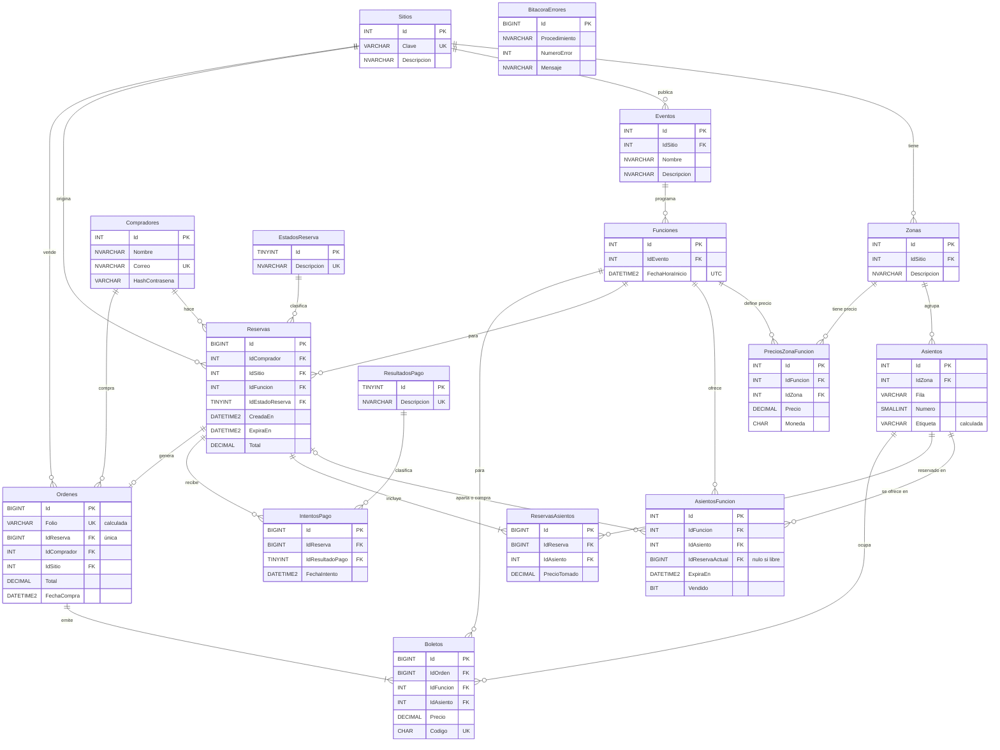

# BCK — Diagrama entidad-relación

Etapa: 3. Definición · Fecha: 5 nov 2026 · Responsable: A (Alfredo)
Detalle de columnas, tipos y restricciones: `docs/BCK_DEFINICION.md` §6.

Para simplificar el diagrama no se repiten las columnas `FechaRegistro` ni `Activo`, que siguen la convención de §6.

## Claves únicas compuestas (no se ven en el diagrama)

| Tabla | Clave única |
| --- | --- |
| `Zonas` | (`IdSitio`, `Descripcion`) |
| `Funciones` | (`IdEvento`, `FechaHoraInicio`) |
| `Asientos` | (`IdZona`, `Fila`, `Numero`) |
| `PreciosZonaFuncion` | (`IdFuncion`, `IdZona`) |
| `AsientosFuncion` | (`IdFuncion`, `IdAsiento`) |
| `ReservasAsientos` | (`IdReserva`, `IdAsiento`) |
| `Boletos` | (`IdFuncion`, `IdAsiento`), que impide vender dos veces un asiento |

`BitacoraErrores` no tiene relaciones: es sólo de uso interno.
